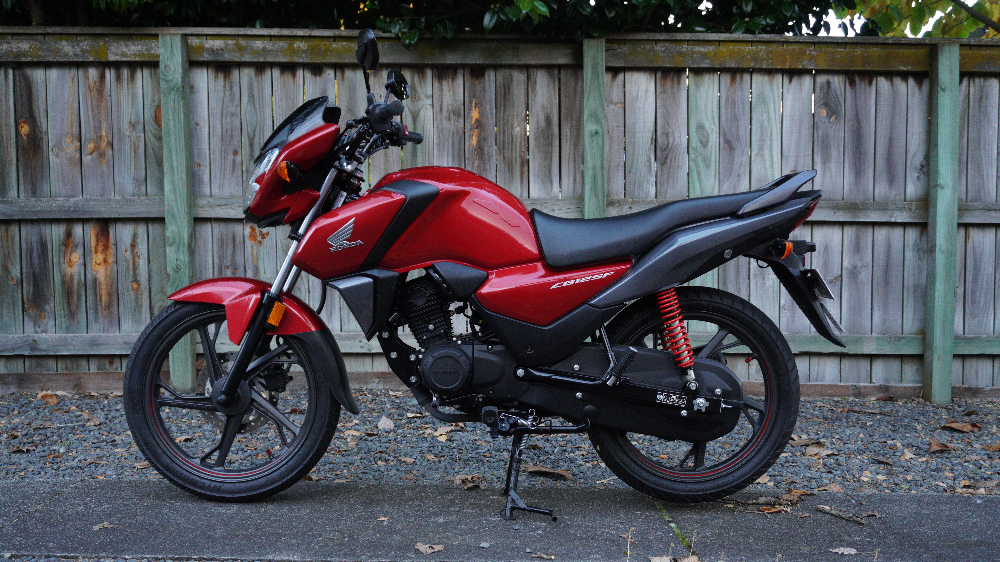
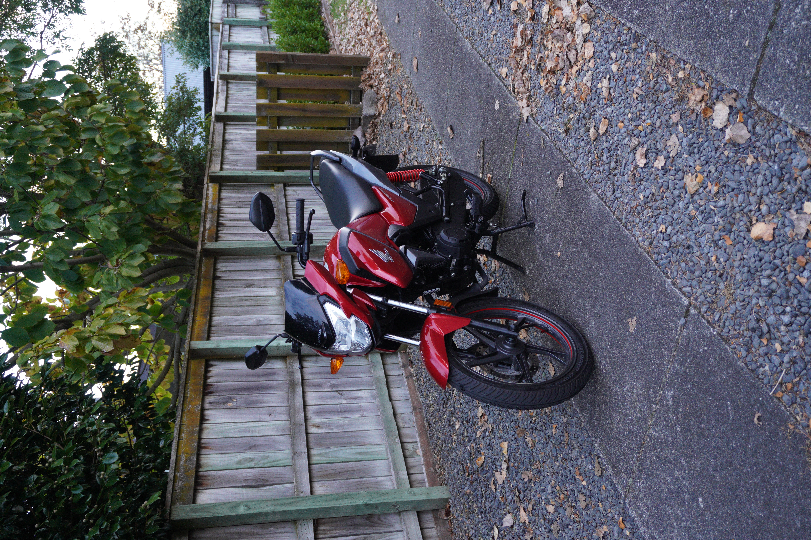
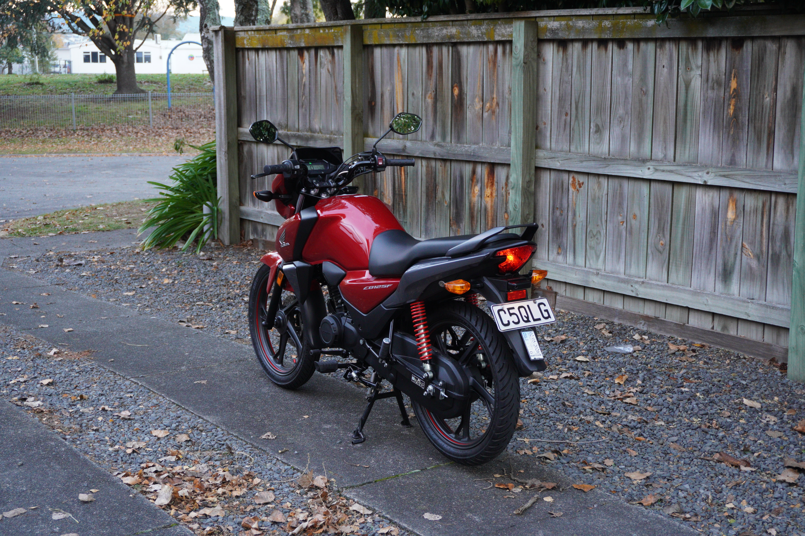

There is a push for less right now, and it’s not hard to identify where it’s coming from. The bombardment of feature bloat in today’s products has got out of control. Screens on fridges, a [subscription to use the heated seats in your car](https://www.drive.com.au/news/bmw-admits-heated-seat-subscriptions-were-a-mistake/), and, of course, AI integrations fucking everywhere. We know this process of [enshitification](https://en.wikipedia.org/wiki/Enshittification) far too well now.

So when a back-to-basics Honda motorbike for under \$3,500 NZD comes to your attention… it seems like just the medicine we need right now.

The Honda CB125F is perhaps the most basic example of a motorbike. Black and white LCD gauge cluster, 5-speed gearbox, 1 L oil capacity - two wheels, a chain… It’s all very simple, and it can get you to work for cents' worth of fuel! The heart of CB125F is the mighty 125 cc air-cooled SOHC one cylinder with *enhanced smart power (eSP)*TM technology. This “eSP” technology lowers internal friction to zap less power away from the wheels, which matters because there is obviously not much power to lose. Honda claims the power output of this little engine is 10.7 HP (don’t forget the .7 - that’s 6.5% of the total power!). Since the power output is closer to cycling power outputs than motor vehicles, that’s 7800 watts for you cyclist out there :cry:.

## Things I like about the CB125F

The CB125F is not purely minimal, though. An LED headlight provides great illumination and improves safety; the *Alternating Current Generator* (ACG) starter technology is excellent, and range and fuel economy are off the charts. Moreover, it has “big bike” ergonomics and ‘normal’ motorbike controls in all the ‘normal’ places. No automatic centrifugal clutch or three-speed gearbox. So the CB125F is very much trying to be a real motorbike, and for under \$3,500, it checks a lot of boxes.

Starting a motorbike isn’t usually a noteworthy experience, but it is with the ACG starter on the CB125F. ACG starters work by reversing the polarity of the alternator's stator. This makes it work in reverse, turning over the crank and starting the bike. The ACG mechanism, combined with the small piston mass, allows the bike to go from off to idle almost imperceptibly. It’s kinda a weird experience - one second it’s off, the next, it’s turning over. No chugga chugga or any indication at all really that the bike was in a “starting” state.

Once riding, unsurprisingly the bike is very flicky and light. It will shoot off wherever you point it, and the suspension does a surprisingly good job at keeping the ride comfortable. Also unsurprisingly, the exhaust note is very quiet - which is kinda cool actually - has an electric vehicle stealthiness to it. It rides well at speed (if you can get it up to speed) and the engine feels under stressed no matter the RPMs. All in all, the CB125F gives you the feeling that this bad boy was designed to start and run, and it will keep doing so no matter how you ride it or what you put it through.

Most importantly, though, is the fuel consumption. I was getting about 50 km/L without even trying to drive economically. At \$3.30/L, that makes a 20km commute \$1.32, and a 15km commute \$0.99! With its 11 L tank that makes the range near 600 kms! Perhaps a sleeper touring bike?!?

## Things I don’t like

Now look, this is a cheap, simple little bike, and its flaws should be pretty obvious. We all know the components are bottom shelf and the power is, as described above, closer to cyclists' outputs than motor vehicles. That said, a cheap bike could have circumvented the following flaws, and the CB125F did not:

- First gear is waaaay too short. Like comically short. I know we’re not working with much power but I think top speed in first is like 10 kph.
- The rear brake is a drum… eh, it’s cheap; let’s let that slide. But the rear brake pedal is connected to the front brake meaning both are applied when the right foot pedal is pressed! OK that’s too far.
- The indicators make a clicking sound when active. Come on man, I’m already trying so hard not to consider this a scooter why you gotta make the scooter indicator sound!
- No ABS (again, forgivable for the price).
- And finally, the engine… details on that below.

## Conclusion

In the same way Kei trucks and dumb phones have become popular in recent years the simplicity and practicality of the Honda CB125F is alluring. But it’s just not motorbike enough to satisfy motorcyclists. With just over 10 HP this bike needs to be pinned all the time. Throttle modulation is no longer part of riding, and you **will** be going under the speed limit often. If at full lean you gassed it the front tyre would not get light and lose traction - what’s more likely is nothing would happen. This zaps so much fun away from riding and puts the CB125F, despite all its efforts, in the scooter category.

Yes, yes, I know; of course this bike doesn’t have any power, it’s a 125! But doesn’t a 250 cc have all the benefits of the CB125F while also not feeling like a scooter? There are diminishing returns going from a 250 cc to a 125 cc. The fuel economy, weight, and cost of the CBF125F will beat any 250 but this comes at the cost of removing fundamentals of what makes motorcycling fun. Isn’t a [GSX250](../suzuki_gixxer_250/index.qmd) fuel efficient *enough*, light *enough*, and cheap *enough* when considering you can still actually ride it like a real motorbike?

In these ways, the CB125F is too weak to enjoy the ride. It will get you from A to B incredibly reliably and cheaply, but the journey will be lacklustre.

