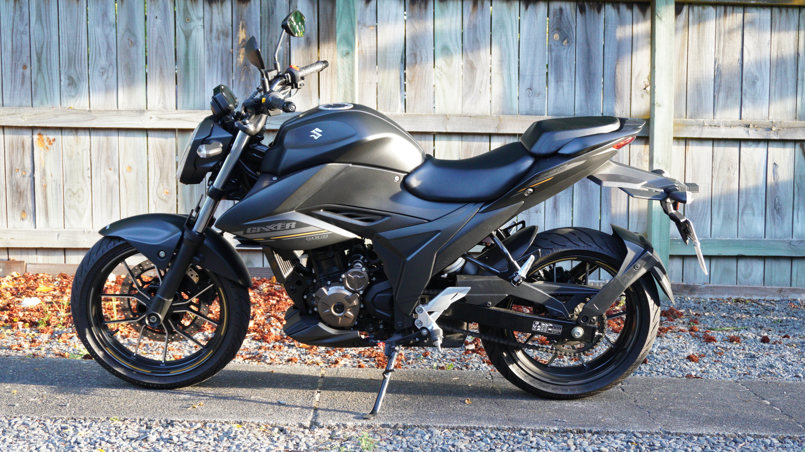
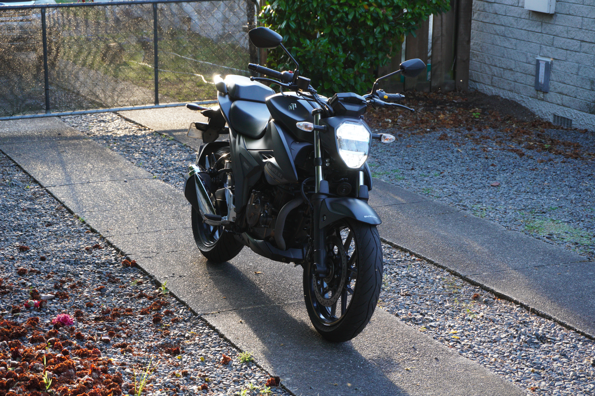

{width=100% fig-align="center"}

I got this bike as a correction to my mistake in buying the [Honda CB125F](../honda_cb125f/index.qmd). I wanted enough power for the bike to be 'usable', while retaining attributes of the Honda I liked. The [Honda](../honda_cb125f/index.qmd) attributes I wanted to retain were tidyness (i.e., new or low kms), fuel efficiency, practically/reliability - and of course, a low price to maximise value. So when a Suzuki GSX 250 with 2300 km's for \$3,860 came up for sale in Wellington, I hopped on the InterCity bus to buy it.

On paper, I don't understand why more people aren't buying this bike. At the time of writing there are only 64 of the RL *naked bike* version registered in NZ.^[According to [vehiclefinder](https://vehiclefinder.co.nz/)] The GSX 250 RL is a stylish, petrol efficient, peppy little bike with modern technology. And the biggest draw - it's \$4,499 NZD brand new!^[At the time of publishing, of course] To be fair, this is a promotion from Suzuki, and its regular price is \$4,999. Either way, that's really cheap for a factory-fresh little commuter. Sure, it's put together in China but surely we can still trust Suzuki engineering.^[The idea that Chinese manufacturing is sub-par I suspect at least partially arises from racist perspectives. It seems abundantly clear in 2026 that China's manufacturing is world-class. Get with the times, and let the evidence speak for itself.] Kawasaki's KLX300 is priced at \$9,177. The Honda GB350S is \$8,995. Even CF MOTO 250 cc bikes are over \$7,400 NZD. The GSX 250 RL would need to be really bad in order to make it (\$4,499) a bad value.

{width=100% fig-align="center"}

Perhaps people are aware of this bike but are blinded by its bad rap. 'Gixxer 250' immediately conjures images broccoli-headed teenage boys with undeveloped frontal lobes. A stereotype that has a lot of overlap with *Surron riders*. If you write off the GSX 250 because of this rider stereotype, that's a shame, for all the usual reasons stereotyping is flawed thinking.

Sadly, this bad rap is not totally unfounded. However, 99% of this bad rap, comes from the GSX 250 **R** *sport bike*, not the **RL** *naked bike* discussed here. People who want to look the part buy the GSX 250 **R**. The **RL** is redeemed by presenting as what it really is - a low performance, cheap runabout. Two very similar bikes with very different buyers.

But let's assume people aren't conflating the rider stereotype of the GSX 250 RL with its sport bike twin and choosing not to buy this bike for that reason; why don't we see more of these bikes in NZ? Clearly others are not seeing good value here. We know the price is unbeaten, so, do we need to expect significantly degraded performance?

{width=90% fig-align="center"}

## Driving the GSX 250 RL
The GSX 250 RL is an excellent urban ride. Gearing is great for city streets, and it's clear Suzuki pushed as much out of this little engine as they could. At high revs it actually packs a noticeable punch. In other words, the engine is *not* understressed. Does that mean it's overstressed? Maybe, and maybe this is why the guy at the shop told me "be careful those engines tend to pop". But I'd rather have an engine pushed to its limits and my wrist modulate engine stress then leave performance untapped. It seems to pull in as much air, and push in as much fuel in as it can! If that makes sense.

Surprisingly the GSX 250 RL is not as 'flicky' as you might suspect, and its geometry promotes longer, sweeping turns. Footpegs rarely rub the ground (for me anyway), the brakes are *fine*, and the gear spacing is perfectly un-notable. That all said, there are a few particularly annoying qualities to this bike.

- The suspension is terrible. Absolute bone-smashing, highway-jittering trash.^[Moreover, if you're a man, the saddle forces your bits right into the gas tank, which essentially rises like a vertical wall from the front of the saddle. So yea, some decent suspension would go a long way here.]
- The bike lets you drive away with the kickstand down AND lets you start it while in gear? That's right, if you try to start the bike in first gear it will let you and lurch forward. Don't ask how I know (lost some aura in town from that one). These are basic safety features Suzuki, come on!
- I would say tiny gas tank, but lets forgive this one. It's a city bike after all and not meant for road tripping.

## Conclusion
The Suzuki GSX 250 RL is a good bike. Suzuki clearly cut corners to keep the price down, but it's stylish, handles well, and squeezes the most out of its little motor as possible. Besides the suspension, this bike is very fun to ride.

So is the Suzuki GSX 250 RL good value? Absolutely. If you're looking to maximise your value on a new, small capacity bike that looks the part, the Suzuki GSX 250 is for you. The build quality will not impress you, and you may become infertile after hitting a pothole, but you won't get on the road having fun with a brand new bike for cheaper then this.

